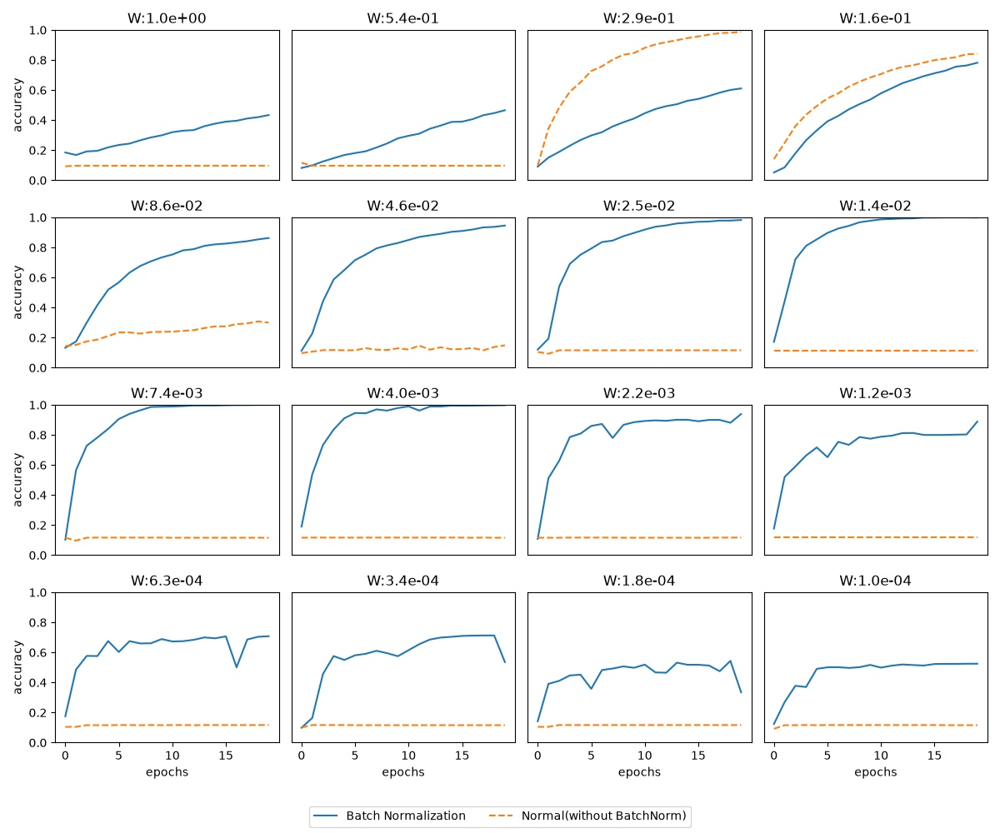

# batch_norm_test.py 实验说明

`batch_norm_test.py` 对比的是**有 Batch Normalization 和没有 Batch Normalization 时,神经网络的学习情况有什么不同**,对应书中 6.3 节。

## 实验设置

- 两个网络结构完全一样,都是 5 个隐藏层,每层 100 个神经元,唯一的区别是一个用了 Batch Norm,一个没用。
- 权重初始值的标准差 `W` 从 1 到 0.0001 取 16 个值(`np.logspace(0, -4, num=16)`),每个值单独训练一次,对应图里的一个子图,子图标题就是这个 `W`。
- 为了让差别更明显,训练数据只用了 1000 条,两个网络都用 SGD 训练 20 个 epoch。
- 横轴是 epoch,纵轴是训练数据上的识别精度。蓝色实线是用了 Batch Norm 的网络,橙色虚线是没用的网络。

## 图中能看到的两点

### 1. 学习更快

`W` 在 `8.6e-02` 到 `4.0e-03` 之间(第二行和第三行前两个子图)时,实线在前几个 epoch 就迅速上升,`W:1.4e-02`、`W:7.4e-03`、`W:4.0e-03` 这三个子图里,实线不到 10 个 epoch 就接近 1.0。

### 2. 对权重初始值不再那么敏感

- **没用 Batch Norm(虚线)**:只有 `W:2.9e-01`、`W:1.6e-01` 这两个子图学得比较好,`W:8.6e-02` 勉强升到 0.3 左右。其余 13 个子图的虚线一直停在 0.1 左右,相当于在 10 个类别里随便猜。
- **用了 Batch Norm(实线)**:16 个子图里,实线全都在上升,精度最终都明显高于 0.1。

`W` 恰好合适的时候(`W:2.9e-01`、`W:1.6e-01`),不用 Batch Norm 的网络反而学得更好。可见 Batch Norm 带来的好处主要体现在初始值不合适的时候。

`W` 取两端时,实线的表现也会变差:
- `W:1.0e+00`、`W:5.4e-01` 时上升很慢,20 个 epoch 后只有 0.4 多。
- `W` 小于等于 `6.3e-04`(最后一行)时,精度停在 0.5~0.7,而且波动明显。

但和同一子图里停在 0.1 不动的虚线比,实线仍然能学下去。所以书里说,有了 Batch Norm,就不用那么费心去挑权重初始值。
